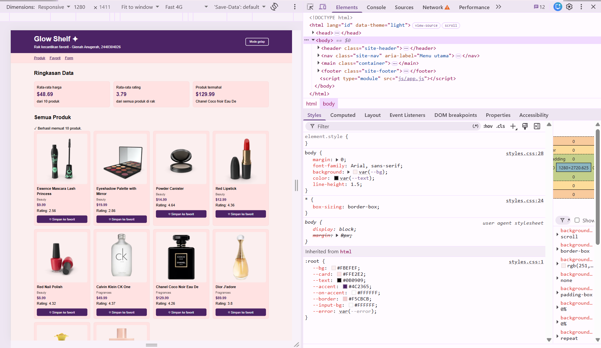
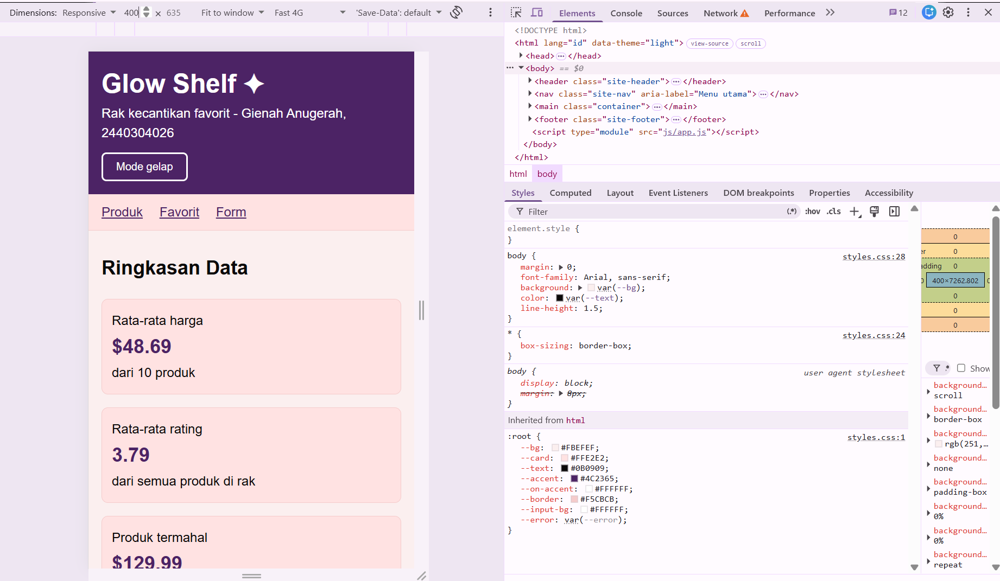
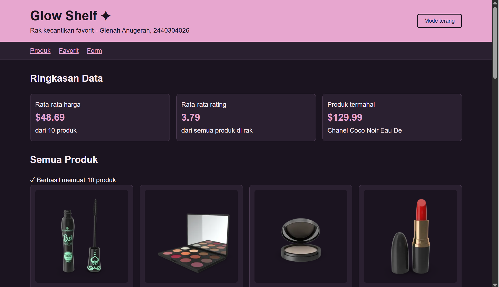
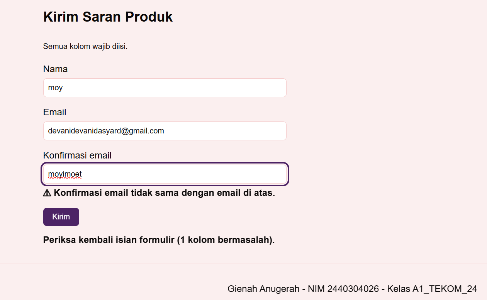

# Glow Shelf

Mini project front-end untuk PTS Pemrograman Web, Program Studi Teknik Komputer, Universitas Borneo Tarakan.

## 1. Identitas

- Nama: Gienah Anugerah 
- NPM: 2440304026
- Kelas: A1_TEKOM_24
- Repository: https://github.com/gienahanugerah-art/glow-shelf
- Video demo: [TEMPEL LINK VIDEO DI SINI]

## 2. Nama aplikasi dan deskripsi singkat

Glow Shelf adalah rak kecantikan sederhana. Produknya diambil dari REST API DummyJSON, lalu ditampilkan sebagai kartu yang berisi gambar, nama, kategori, harga, dan rating. Produk yang disukai bisa disimpan ke daftar favorit, dan daftar itu tetap ada walaupun halaman ditutup. Di bagian atas ada ringkasan data (rata-rata harga, rata-rata rating, dan produk termahal), di bagian bawah ada form untuk mengirim saran produk, dan ada tombol untuk ganti tampilan terang atau gelap.

Hanya produk dari kategori yang cocok untuk rak kecantikan yang ditampilkan (`beauty`, `fragrances`, dan `skin-care`). Daftar kategorinya ada di `js/config.js`.

## 3. Perhitungan variasi soal berdasarkan NPM

NPM-ku berakhir 026, jadi X = 0, Y = 2, dan Z = 6.

| Komponen | Digit | Hasil |
|---|---|---|
| Dataset | X = 0 | Products (`https://dummyjson.com/products`) |
| Fitur utama | Y = 2 | Favorite/Bookmark menggunakan localStorage |
| Validasi form | Z = 6 | Email valid + konfirmasi email |

Challenge individual:

- S = X + Y + Z = 0 + 2 + 6 = 8
- C = S mod 4 = 8 mod 4 = 0
- C = 0 berarti Light/Dark Mode, dan pilihan tema disimpan di localStorage

## 4. Dataset dan API yang digunakan

DummyJSON Products: `https://dummyjson.com/products?limit=30`

Alamat API dan batas jumlah produk ditaruh di `js/config.js` supaya kalau ada yang berubah cukup diganti di satu tempat.

## 5. Fitur utama dan challenge

- Daftar produk dari REST API (fetch, async/await, try...catch)
- Status loading, berhasil, dan gagal yang ditampilkan di halaman
- Favorit (Y = 2): simpan atau hapus produk dari favorit, datanya disimpan di localStorage
- Ringkasan data yang dihitung dengan JavaScript (pakai `reduce`): rata-rata harga, rata-rata rating, dan produk termahal
- Form saran produk (Z = 6) dengan validasi email dan konfirmasi email
- Mode terang/gelap (C = 0), pilihan tersimpan di localStorage
- Tampilan responsive: 4 kolom di desktop, 2 kolom di tablet, 1 kolom di mobile

## 6. Cara menjalankan project

Project ini memakai `type="module"` di JavaScript, jadi harus dibuka lewat server lokal. Kalau `index.html` dibuka dengan klik dua kali, JavaScript-nya tidak akan jalan. Aku memakai Laragon.

1. Download atau clone repository ini.
2. Taruh foldernya di `www` milik Laragon, misalnya `D:\laragon\www\glow-shelf`.
3. Jalankan Laragon (Start All).
4. Buka `http://localhost/glow-shelf/` di browser.
5. Komputer harus terhubung ke internet karena datanya diambil dari DummyJSON.

Struktur folder:

```
glow-shelf
├── css
│   └── styles.css
├── js
│   ├── app.js
│   └── config.js
├── screenshots
├── index.html
├── AI_USAGE_LOG.md
└── README.md
```

## 7. Screenshots

Tampilan desktop:



Tampilan mobile:



Tampilan mode gelap:



Tampilan form dengan pesan error:



## 8. Endpoint REST API

| Method | Endpoint | Keterangan |
|---|---|---|
| GET | `https://dummyjson.com/products?limit=30` | Mengambil 30 produk pertama |

Balasan API berupa objek JSON. Daftar produknya ada di `products` (array), dan ada juga `total`, `skip`, dan `limit`. Field yang kupakai di setiap produk: `id`, `title`, `category`, `price`, `rating`, dan `thumbnail`.

## 9. Jawaban pertanyaan penjelasan kode

**1. Jelaskan alur sejak halaman dibuka sampai data REST API tampil.**

Saat halaman dibuka, browser membaca `index.html`, lalu memuat `css/styles.css` dan `js/app.js` (sebagai module). `app.js` mengimpor pengaturan dari `config.js`, mengambil elemen-elemen halaman dengan `getElementById`, dan membaca daftar favorit dari localStorage lewat `bacaFavorit()`. Di bagian paling bawah file, `terapkanTema(bacaTema())` memasang tema yang tersimpan, lalu `ambilProduk()` dipanggil.

Di `ambilProduk()`, pertama `tampilkanStatus()` menampilkan tulisan "Memuat produk...". Setelah itu `fetch()` meminta data ke API dan `await` menunggu balasannya. Balasan dicek dengan `response.ok`, lalu diubah jadi objek dengan `response.json()`. Produknya disaring sesuai `KATEGORI_RAK` dan disimpan di `semuaProduk`. Terakhir `tampilkanProduk()`, `tampilkanFavorit()`, dan `tampilkanStatistik()` dipanggil supaya data muncul di halaman, dan `tampilkanStatus()` menampilkan pesan berhasil.

**2. Mengapa setelah `fetch()` selesai masih perlu memeriksa `response.ok`?**

`fetch()` hanya dianggap gagal kalau permintaannya tidak sampai ke server, misalnya internet putus. Kalau server membalas dengan status 404 atau 500, `fetch()` tetap dianggap berhasil dan kode di bawahnya terus berjalan. Makanya status harus dicek sendiri.

Di aplikasiku, aku pernah mencoba mengganti `products` jadi `produts` di `API_URL` untuk percobaan. Server membalas 404. Tanpa pengecekan `response.ok`, program akan lanjut mengolah balasan error itu seakan-akan data produk. Dengan pengecekan, aku melempar error `HTTP Error: 404` dan langsung ditangkap `catch`, sehingga pesan errornya jelas dan aplikasi tidak rusak.

**3. Pilih satu data JSON dari API dan jelaskan bagaimana data tersebut diubah menjadi elemen DOM yang terlihat.**

Aku ambil contoh produk "Essence Mascara Lash Princess". Datanya berbentuk objek JSON yang isinya `title`, `category`, `price`, `rating`, dan `thumbnail`. Objek ini dikirim ke fungsi `buatKartu()`. Di sana aku membuat elemen dengan `document.createElement`: `title` dimasukkan ke `<h3>` lewat `textContent`, `thumbnail` dipasang ke `src` pada `` (dengan `title` sebagai `alt`), dan `price` diubah oleh `formatHarga()` jadi tulisan `$9.99` di elemen `<p>`. Semua elemen digabung ke dalam satu `<article class="card">`, lalu `tampilkanProduk()` menempelkannya ke `<div id="product-list">` dengan `appendChild`. Di saat itu kartunya muncul di halaman.

Aku memakai `textContent`, bukan `innerHTML`, supaya isi dari API dianggap teks biasa dan bukan kode HTML.

**4. Apa yang terjadi jika internet terputus, endpoint salah, atau server mengembalikan HTTP 404/500?**

- Internet terputus: `fetch()` gagal sebelum mendapat balasan dan melempar error. Error itu ditangkap blok `catch`.
- Endpoint salah atau server membalas 404/500: `fetch()` berhasil dapat balasan, tapi `response.ok` bernilai `false`. Aku lempar error sendiri dengan `throw new Error('HTTP Error: ...')`, dan error itu juga ditangkap `catch`.

Dalam semua kasus, `catch` memanggil `tampilkanStatus()` untuk menampilkan pesan gagal berwarna error di halaman, berisi alasan singkat dan saran memeriksa koneksi, lalu mencatat error ke Console dengan `console.error`. Halaman tetap tampil dan tidak rusak.

**5. Jelaskan bagaimana fitur berdasarkan digit Y bekerja.**

Y = 2 berarti fitur favorit dengan localStorage. Setiap kartu punya tombol favorit (dibuat di `buatKartu()`) dengan `data-id` berisi id produk. Event `click` dipasang di `productList` dan `favoriteList`, bukan di setiap tombol, lalu ditangani `tanganiKlikFavorit()`. Cara ini disebut event delegation, dan `event.target.closest('.btn-favorit')` dipakai untuk mencari tombol yang diklik.

Fungsi `toggleFavorit(id)` menambahkan id ke array `favoritIds` kalau belum ada, dan membuangnya dengan `filter` kalau sudah ada. Setelah itu `simpanFavorit()` menulis array ke localStorage. Terakhir `tampilkanProduk()` dan `tampilkanFavorit()` dipanggil lagi supaya tampilan ikut berubah. `tampilkanFavorit()` memakai `filter` untuk mengambil produk yang id-nya ada di daftar favorit.

**6. Jelaskan bagaimana validasi berdasarkan digit Z bekerja dan mengapa input tidak valid tidak boleh langsung diproses.**

Z = 6 berarti email harus valid dan ada konfirmasi email. Saat tombol Kirim diklik, event `submit` ditangani `tanganiSubmitForm()`. Pertama `event.preventDefault()` menahan form supaya halaman tidak dimuat ulang. Lalu `bacaDataForm()` mengambil isian dan merapikannya dengan `trim()` dan `toLowerCase()`, dan `validasiSaran()` memeriksa:

- Nama tidak boleh kosong.
- Email tidak boleh kosong dan harus cocok dengan pola `POLA_EMAIL`.
- Konfirmasi email tidak boleh kosong dan harus sama persis dengan email.

Kalau ada yang salah, pesan error berupa tulisan (diawali tanda ⚠) ditampilkan di bawah kolom yang bermasalah, kolomnya diberi `aria-invalid`, dan fokus dipindah ke kolom pertama yang salah. Jadi kesalahan tidak hanya ditunjukkan dengan warna. Kalau semua valid, muncul pesan berhasil.

Input yang tidak valid tidak boleh langsung diproses karena bisa menghasilkan data yang rusak atau tidak bisa dipakai. Contohnya, email yang salah ketik berarti pengguna tidak bisa dihubungi lagi. Data yang belum diperiksa juga bisa menyebabkan error di bagian program yang memakainya.

**7. Data apa yang disimpan di localStorage, kapan dibaca/diubah, dan alasannya?**

Ada dua data:

- `glowshelf_favorit`: array id produk favorit, misalnya `[1,3]`. Dibaca saat halaman dibuka oleh `bacaFavorit()`, dan diubah setiap kali tombol favorit diklik oleh `toggleFavorit()` yang memanggil `simpanFavorit()`. Setelah data produk dimuat, id favorit yang produknya tidak ada di rak juga dibuang.
- `glowshelf_tema`: pilihan tema, `light` atau `dark`. Dibaca saat halaman dibuka oleh `bacaTema()`, dan diubah saat tombol tema diklik oleh `ubahTema()`.

Alasannya supaya pilihan pengguna tidak hilang saat halaman ditutup atau dimuat ulang. localStorage hanya bisa menyimpan teks, jadi array diubah dengan `JSON.stringify` saat disimpan dan `JSON.parse` saat dibaca.

**8. Pilih satu fungsi JavaScript penting, lampirkan potongan maksimal 15 baris, lalu jelaskan input - proses - output.**

```js
function toggleFavorit(id) {
  if (favoritIds.includes(id)) {
    favoritIds = favoritIds.filter((item) => item !== id);
  } else {
    favoritIds.push(id);
  }
  simpanFavorit();
}
```

- Input: `id`, yaitu nomor id produk yang tombol favoritnya diklik.
- Proses: fungsi mengecek dengan `includes` apakah id itu sudah ada di `favoritIds`. Kalau sudah ada, id dibuang dengan `filter`. Kalau belum, id ditambahkan dengan `push`. Setelah itu `simpanFavorit()` dipanggil untuk menulis hasilnya ke localStorage.
- Output: fungsi ini tidak mengembalikan nilai. Hasilnya berupa `favoritIds` yang sudah berubah dan tersimpan di localStorage, sehingga tampilan bisa diperbarui sesudahnya.

**9. Bug/error paling sulit selama PTS.**

Setelah menambah fitur baru, kartu produk, tombol favorit, dan form tidak ada yang berfungsi sama sekali. Penyebabnya, `app.js` mengimpor `KATEGORI_RAK` dari `config.js`, padahal nama itu belum aku tambahkan di `config.js`. Karena impor gagal, seluruh `app.js` tidak dijalankan.

Aku menemukannya dengan membuka Console di Developer Tools. Di sana ada pesan merah `SyntaxError: The requested module './config.js' does not provide an export named 'KATEGORI_RAK'`, lengkap dengan nama file dan nomor barisnya. Aku memperbaikinya dengan menambahkan `export const KATEGORI_RAK` di `config.js`. Dari sini aku belajar kalau halaman tiba-tiba kosong, hal pertama yang dicek adalah Console.

**10. Jika diberi satu minggu lagi, dua perbaikan teknis yang akan dilakukan.**

1. Menambahkan tombol "Coba lagi" saat data gagal dimuat. Sekarang kalau gagal, pengguna harus memuat ulang halaman sendiri. Dengan tombol itu, `ambilProduk()` cukup dipanggil lagi tanpa memuat ulang seluruh halaman.
2. Menambahkan pencarian dan filter kategori, karena sekarang semua produk ditampilkan sekaligus. Dengan begitu pengguna bisa menemukan produk lebih cepat, dan fungsi `filter` yang sudah dipakai bisa dimanfaatkan lagi.

## 10. AI Usage Log

Selama mengerjakan PTS ini aku memakai Claude dan Gemini sebagai pemandu langkah pengerjaan, sumber contoh kode, dan bantuan membaca pesan error. Semua kode kucoba sendiri di browser, kupelajari alurnya, dan kujelaskan ulang dengan bahasaku sendiri.
 


| Tanggal | AI / Tool | Tujuan | Prompt / Ringkasan Diskusi | Bagian Digunakan | Verifikasi & Modifikasi |
|---|---|---|---|---|---|
| 14 Okt 2026 | Gemini & Claude | Penyusunan Layout & CSS Reset | Mendiagnosis overflow horizontal di layar mobile 320px dan mengatur grid responsif. | `css/styles.css` | Mengubah unit CSS dan menambahkan override `!important` untuk atribut inline `width` agar halaman tidak meluber di layar HP. |
| 15 Okt 2026 | Gemini & Claude | Perbaikan Alur `app.js` & Form Validation | Memperbaiki letak fungsi `tampilkanStatistik()`, menyusun fungsi `validasiSaran()`, dan event listener form. | `js/app.js` | Menguji pengiriman form kosong (memastikan pesan error dan fokus muncul) serta form terisi benar. |
| 15 Okt 2026 | Claude | Mencari penyebab halaman kosong | Mengirim screenshot Console dan isi `app.js` karena kartu, favorit, dan form tidak berfungsi | `js/config.js` | Pesan error di Console menunjukkan `KATEGORI_RAK` belum diekspor. Setelah kutambahkan, halaman tampil normal |
| 15 Okt 2026 | Claude | Draf README dan naskah video | Minta draf README sesuai bagian H di soal, jawaban 10 pertanyaan, dan urutan tampilan untuk video demo | `README.md`, naskah video | Draf kubaca, kucocokkan dengan kode asli, dan kusesuaikan bahasanya |
| 16 Okt 2026 | Gemini & Claude | Konsultasi Laporan, Git, & AI Log | Penyusunan laporan refleksi, pembuatan tag Git `v0.1-PTS`, dan penyusunan AI Usage Log. | `README.md`, `AI_USAGE_LOG.md`, Terminal Git | Mengecek hasil `git log --oneline`, memverifikasi fungsionalitas di browser, dan menguji aksesibilitas keyboard (`Tab`). |


---

### Pernyataan Integritas
Seluruh kode yang dihasilkan dengan bantuan AI telah diuji, dipahami alur logikanya, serta divalidasi secara mandiri sesuai dengan ketentuan variabel NPM PTS Pemrograman Web UBT.